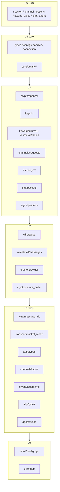

# yanterm-ssh 公共 API 清单

本文档只罗列公开 API，不描述规格和约束.

## 0. 模块与依赖

每层只能向下依赖。

| 层 | 内容 |
| --- | --- |
| L0 | `detail/config.hpp`、`error.hpp` |
| L1 词汇 | `wire/message_ids`、`transport/packet_mode`、`auth/types`、`channels/types`、`crypto/algorithms`、`sftp/types`、`agent/types` |
| L2 | `wire/types` + `wire/detail/messages`、`crypto/provider`、`crypto/secure_buffer` |
| L3 | `crypto/openssl`、`keys/**`、`kex/algorithms` + `kex/detail/tables`、`channels/requests`、`memory/**`、`sftp/packets`、`agent/packets` |
| L4 | `core/**`（`types` / `config` / `handler` / `connection` 公开，`detail/**` 私有） |
| L5 门面 | `facade_types.hpp`、`options.hpp`、`session.hpp`、`channel.hpp`、`sftp.hpp`、`agent.hpp`、`detail/session_impl.hpp` |



## 1. 协程包装门面

- [yanterm-ssh/session.hpp](include/yanterm-ssh/session.hpp)
- [yanterm-ssh/channel.hpp](include/yanterm-ssh/channel.hpp)
- [yanterm-ssh/options.hpp](include/yanterm-ssh/options.hpp)
- [yanterm-ssh/facade_types.hpp](include/yanterm-ssh/facade_types.hpp)

### [yanterm-ssh/facade_types.hpp](include/yanterm-ssh/facade_types.hpp)

```
namespace yanterm::ssh

using disconnect_reason
using auth_result
using auth_verdict
using verdict_kind              // auth_verdict::kind
using kbdint_prompt
using publickey_sign_request
using channel_id
using channel_open_reason
using channel_type
using pty_spec
using x11_req_spec
using window_size
using exit_signal

struct disconnect_info          // 对端或本端 DISCONNECT
struct sign_result              // signer 的结果
struct kbdint_answers           // challenge 多提示应答
struct kbdint_answer            // challenge 单提示应答
class host_key_view             // 握手时交给客户端校验的主机公钥
class auth_request              // 服务端 authenticate 回调入参

host_key_view::key
host_key_view::fingerprint

auth_request::user
auth_request::service
auth_request::method
auth_request::has_signature
auth_request::algorithm
auth_request::public_blob
auth_request::password
auth_request::challenge
```

### [yanterm-ssh/options.hpp](include/yanterm-ssh/options.hpp)

```
namespace yanterm::ssh

default_max_pending_requests   // max_pending_requests == 0 时的钳制值
struct session_options          // 握手与限流默认值
struct client_options           // 另含 on_banner
struct server_options           // 另含 host_keys、认证横幅与用户公钥认证算法列表
```

### [yanterm-ssh/session.hpp](include/yanterm-ssh/session.hpp)

```
namespace yanterm::ssh

concept publickey_signer        // 公钥签名回调
struct global_request_result    // send_global_request 的结果
class session                   // 会话基类：I/O 循环、开通道、全局请求
class client_session            // 客户端：handshake 与认证
class server_session            // 服务端：handshake 与 authenticate
struct reject_inbound_t         // serve 的入站处理器：一律拒绝
reject_inbound                  // reject_inbound_t 的实例

session::disconnect
session::serve
session::open_channel
session::open_session_channel
session::open_auth_agent
session::open_direct_tcpip
session::open_direct_streamlocal
session::open_forwarded_tcpip
session::open_x11
session::open_forwarded_streamlocal
session::request_tcpip_forward
session::cancel_tcpip_forward
session::request_streamlocal_forward
session::cancel_streamlocal_forward
session::send_global_request
session::rekey
session::send_keepalive
session::until_closed
session::failure
session::failure_detail
session::disconnected
session::peer_identification
session::session_id
session::initial_host_key
session::initial_kex_signature
session::supports_hostbound_publickey
session::supports_agent_forward
session::negotiated

client_session::handshake
client_session::auth_none
client_session::auth_password
client_session::auth_publickey_query  // 询问公钥是否可用（USERAUTH_PK_OK）
client_session::auth_publickey  // 两个重载：进程内私钥 / 公钥 + 外部 signer
client_session::auth_keyboard_interactive

server_session::handshake
server_session::authenticate
```

### [yanterm-ssh/channel.hpp](include/yanterm-ssh/channel.hpp)

```
namespace yanterm::ssh

class channel                   // 已打开通道；满足 auv stream_like
class extended_stream           // channel 的带外数据流，满足 auv stream_like
struct channel_open_result      // 出站开通道结果
class inbound_channel_open      // 入站 CHANNEL_OPEN；析构未结算则拒绝
class inbound_channel_request   // 入站 CHANNEL_REQUEST
class inbound_global_request    // 入站 GLOBAL_REQUEST；析构未结算则拒绝

channel::read
channel::write
channel::shutdown
channel::close
channel::extended
channel::stderr_stream          // extended(extended_data_stderr)

extended_stream::read
extended_stream::write
extended_stream::shutdown
extended_stream::close
extended_stream::type
extended_stream::operator bool

channel::request_pty
channel::request_shell
channel::request_exec
channel::request_subsystem
channel::request_auth_agent
channel::request_env
channel::request_window_change
channel::request_signal
channel::send_exit_status
channel::send_exit_signal
channel::request_x11
channel::send_request
channel::serve_requests

inbound_channel_open::type
inbound_channel_open::request_type
inbound_channel_open::host
inbound_channel_open::port
inbound_channel_open::originator_host
inbound_channel_open::originator_port
inbound_channel_open::socket_path
inbound_channel_open::payload
inbound_channel_open::accept
inbound_channel_open::reject

inbound_channel_request::type
inbound_channel_request::payload
inbound_channel_request::want_reply
inbound_channel_request::pty
inbound_channel_request::exec_command
inbound_channel_request::subsystem
inbound_channel_request::env
inbound_channel_request::window_change
inbound_channel_request::signal
inbound_channel_request::exit_status
inbound_channel_request::exit_signal
inbound_channel_request::x11

inbound_global_request::type
inbound_global_request::payload
inbound_global_request::want_reply
inbound_global_request::accept
inbound_global_request::reject
```

## 2. 核心协议（sans-I/O）

- [yanterm-ssh/core/types.hpp](include/yanterm-ssh/core/types.hpp)
- [yanterm-ssh/core/config.hpp](include/yanterm-ssh/core/config.hpp)
- [yanterm-ssh/core/handler.hpp](include/yanterm-ssh/core/handler.hpp)
- [yanterm-ssh/core/connection.hpp](include/yanterm-ssh/core/connection.hpp)
- [yanterm-ssh/wire/message_ids.hpp](include/yanterm-ssh/wire/message_ids.hpp)
- [yanterm-ssh/wire/types.hpp](include/yanterm-ssh/wire/types.hpp)
- [yanterm-ssh/kex/algorithms.hpp](include/yanterm-ssh/kex/algorithms.hpp)
- [yanterm-ssh/transport/packet_mode.hpp](include/yanterm-ssh/transport/packet_mode.hpp)
- [yanterm-ssh/auth/types.hpp](include/yanterm-ssh/auth/types.hpp)
- [yanterm-ssh/channels/types.hpp](include/yanterm-ssh/channels/types.hpp)
- [yanterm-ssh/channels/requests.hpp](include/yanterm-ssh/channels/requests.hpp)

### [yanterm-ssh/core/types.hpp](include/yanterm-ssh/core/types.hpp)

```
namespace yanterm::ssh::core

enum class role                 // client / server
enum class host_key_verdict     // 主机密钥裁决
struct publickey_sign_request   // 公钥认证待签请求：algorithm、crypto::sig_id 与公钥 blob
```

### [yanterm-ssh/core/config.hpp](include/yanterm-ssh/core/config.hpp)

```
namespace yanterm::ssh::core

struct config                   // sans-I/O 连接配置
```

### [yanterm-ssh/core/handler.hpp](include/yanterm-ssh/core/handler.hpp)

```
namespace yanterm::ssh::core

struct channel_ref              // 通道引用
class host_key_ticket           // 客户端主机密钥
class auth_ticket               // 服务端 USERAUTH_REQUEST
class kbdint_ticket             // 客户端 USERAUTH_INFO_REQUEST
class open_ticket               // 入站 CHANNEL_OPEN
class channel_request_ticket    // 入站 CHANNEL_REQUEST
class global_request_ticket     // 入站 GLOBAL_REQUEST
class handler                   // 虚函数回调；构造 connection 时传入

handler::on_peer_identification
handler::on_host_key
handler::on_handshake_done
handler::on_rekey_done
handler::on_debug
handler::on_ignore
handler::on_disconnect
handler::on_auth_banner
handler::on_auth_result
handler::on_kbdint_request
handler::on_auth_request
handler::on_kbdint_response
handler::on_open_request
handler::on_open_result
handler::on_channel_request
handler::on_channel_reply
handler::on_global_request
handler::on_global_reply
handler::on_readable
handler::on_writable
handler::on_eof
handler::on_closed
handler::on_released
```

### [yanterm-ssh/core/connection.hpp](include/yanterm-ssh/core/connection.hpp)

```
namespace yanterm::ssh::core

class connection                // sans-I/O 连接状态机
struct connection::host_key_spec

connection::set_host_key
connection::set_host_keys
connection::feed
connection::pending_output
connection::pending_output0
connection::pending_output_bytes
connection::consume_output

connection::inbound_requests_stalled
connection::resolve

connection::auth_none
connection::auth_password
connection::auth_publickey          // 用户公钥认证（进程内私钥）
connection::auth_publickey_sign_request
connection::auth_publickey_signed   // 用户公钥认证（外部私钥，如 auth agent）
connection::auth_publickey_query
connection::auth_keyboard_interactive
connection::send_auth_banner

connection::open_channel
connection::abandon_open
connection::channel_eof
connection::channel_close
connection::channel_write
connection::channel_write_extended
connection::channel_read
connection::capture_extended_data
connection::release_extended_data
connection::channel_request
connection::send_global_request

connection::send_ignore
connection::send_debug
connection::disconnect
connection::rekey

connection::peer_identification
connection::negotiated
connection::session_id
connection::initial_host_key
connection::initial_kex_signature
connection::supports_hostbound_publickey
connection::supports_agent_forward
connection::outbound_sequence_number
connection::failure
connection::failure_detail
```

### [yanterm-ssh/wire/message_ids.hpp](include/yanterm-ssh/wire/message_ids.hpp)

```
namespace yanterm::ssh::wire

enum class msg                  // RFC 消息号
enum class disconnect_reason    // RFC 4253 断连原因
```

### [yanterm-ssh/wire/types.hpp](include/yanterm-ssh/wire/types.hpp)

```
namespace yanterm::ssh::wire

class name_list                 // RFC 4251 name-list 视图
class reader                    // 从 span 解包
class writer                    // 组包；take() 移出缓冲

name_list::raw
name_list::empty
name_list::begin
name_list::end
name_list::contains

reader::ok
reader::error
reader::offset
reader::remaining
reader::empty
reader::read_bytes
reader::read_byte
reader::read_bool
reader::read_uint32
reader::read_uint64
reader::read_string
reader::read_mpint
reader::read_name_list
reader::fail

writer::write_byte
writer::write_bool
writer::write_uint32
writer::write_uint64
writer::write_bytes
writer::write_string
writer::write_mpint
writer::write_name_list
writer::data
writer::size
writer::take
writer::clear
writer::reserve
```

### [yanterm-ssh/kex/algorithms.hpp](include/yanterm-ssh/kex/algorithms.hpp)

```
namespace yanterm::ssh::kex

struct negotiated               // 协商结果
default_kex_algorithms          // 逗号分隔 name-list
supported_kex_algorithms
default_host_key_algorithms
supported_host_key_algorithms
default_cipher_algorithms
supported_cipher_algorithms
default_mac_algorithms
supported_mac_algorithms
```

### [yanterm-ssh/transport/packet_mode.hpp](include/yanterm-ssh/transport/packet_mode.hpp)

```
namespace yanterm::ssh::transport

enum class packet_mode          // 明文 / CTR-MAC / CTR-ETM / CBC-MAC / CBC-ETM / GCM / ChaCha
```

### [yanterm-ssh/auth/types.hpp](include/yanterm-ssh/auth/types.hpp)

```
namespace yanterm::ssh::auth

enum class method
parse_method
method_name
struct kbdint_prompt            // keyboard-interactive 提示
struct auth_result              // 客户端认证回复
enum class verdict_kind         // success / failure / info
struct auth_verdict             // 服务端认证裁决

auth_verdict::success
auth_verdict::failure
auth_verdict::info
```

### [yanterm-ssh/channels/types.hpp](include/yanterm-ssh/channels/types.hpp)

```
namespace yanterm::ssh::channels

using channel_id
enum class channel_type
enum class channel_open_reason
type_name
parse_type
type_session
type_direct_tcpip
type_forwarded_tcpip
type_x11
type_direct_streamlocal
type_forwarded_streamlocal
type_auth_agent
type_agent_connect
max_channel_data_payload
extended_data_stderr
struct channel_open_spec        // 出站开通道：type、extra、窗口
channel_open_spec::type
channel_open_spec::extra
struct channel_open_verdict     // 入站开通道裁决
struct window_size
struct pty_spec
struct x11_req_spec
struct exit_signal

channel_open_verdict::accepted
channel_open_verdict::rejected
```

### [yanterm-ssh/channels/requests.hpp](include/yanterm-ssh/channels/requests.hpp)

```
namespace yanterm::ssh::channels

encode_pty_req / decode_pty_req
encode_exec / decode_exec
encode_subsystem / decode_subsystem
encode_env / decode_env
encode_window_change / decode_window_change
encode_signal / decode_signal
encode_exit_status / decode_exit_status
encode_exit_signal / decode_exit_signal
encode_direct_tcpip / decode_direct_tcpip
encode_x11 / decode_x11
encode_x11_req / decode_x11_req
encode_streamlocal / decode_streamlocal
encode_forwarded_streamlocal / decode_forwarded_streamlocal
encode_tcpip_forward / decode_tcpip_forward
encode_streamlocal_forward / decode_streamlocal_forward
```

## 3. 加密提供者

- [yanterm-ssh/crypto/algorithms.hpp](include/yanterm-ssh/crypto/algorithms.hpp)
- [yanterm-ssh/crypto/secure_buffer.hpp](include/yanterm-ssh/crypto/secure_buffer.hpp)
- [yanterm-ssh/crypto/provider.hpp](include/yanterm-ssh/crypto/provider.hpp)
- [yanterm-ssh/crypto/openssl.hpp](include/yanterm-ssh/crypto/openssl.hpp)
- [yanterm-ssh/crypto/openssl3.hpp](include/yanterm-ssh/crypto/openssl3.hpp)
- [yanterm-ssh/crypto/openssl11.hpp](include/yanterm-ssh/crypto/openssl11.hpp)

### [yanterm-ssh/crypto/algorithms.hpp](include/yanterm-ssh/crypto/algorithms.hpp)

```
namespace yanterm::ssh::crypto

enum class hash_id
enum class cipher_id
enum class mac_id
enum class kex_id
enum class kem_id
enum class sig_id
enum class primitive_kind
struct public_key_material      // 验签用公钥分量
struct signature_material
struct private_key_material     // 签名用私钥分量

hash_output_size
cipher_key_size
cipher_block_size
cipher_iv_size
is_rsa_sig
is_ecdsa_sig
is_sm2_sig
generated_key_storage_size
kex_public_size
kex_secret_size
kem_public_size
kem_ciphertext_size
kem_secret_size
secure_zero                     // span<std::byte>
```

### [yanterm-ssh/crypto/secure_buffer.hpp](include/yanterm-ssh/crypto/secure_buffer.hpp)

```
namespace yanterm::ssh::crypto

class secure_bytes
class secure_string
template <std::size_t N> class secure_array

secure_bytes::assign
secure_bytes::append
secure_bytes::reserve
secure_bytes::wipe
secure_bytes::data
secure_bytes::size
secure_bytes::span
secure_string::assign
secure_string::wipe
secure_string::view
secure_array::span
```

### [yanterm-ssh/crypto/provider.hpp](include/yanterm-ssh/crypto/provider.hpp)

```
namespace yanterm::ssh::crypto

struct provider_vtable          // 类型擦除槽；实现者走 wrap/decorate，不手写
class hash_ctx
class hmac_ctx
class cipher
class aead_cipher
class kex_agreement
class kem_keypair
class signing_key
class provider                  // 加密后端句柄

hash_ctx::update
hash_ctx::final_into
hmac_ctx::update
hmac_ctx::final_into
cipher::set_iv
cipher::update
aead_cipher::begin
aead_cipher::update
aead_cipher::final
kex_agreement::public_value
kex_agreement::agree
kem_keypair::public_key
kem_keypair::decapsulate
signing_key::sign

provider::wrap
provider::decorate
provider::supports
provider::random_bytes
provider::constant_time_eq
provider::new_hash
provider::new_hmac
provider::new_cipher
provider::new_aead
provider::new_kex
provider::new_kem
provider::encapsulate
provider::new_signing_key
provider::poly1305
provider::verify
provider::cbc_crypt
provider::generate_keypair
provider::hash
```

### [yanterm-ssh/crypto/openssl.hpp](include/yanterm-ssh/crypto/openssl.hpp)

```
namespace yanterm::ssh::crypto

using openssl_backend           // OpenSSL 后端；经 provider::wrap 接入；按编译时版本取 ossl3 或 ossl1_1 的实现
```

### [yanterm-ssh/crypto/openssl3.hpp](include/yanterm-ssh/crypto/openssl3.hpp)

```
namespace yanterm::ssh::crypto::ossl3

using openssl_backend           // 基于 OpenSSL 3.x API；需要 OpenSSL 3.0+
```

### [yanterm-ssh/crypto/openssl11.hpp](include/yanterm-ssh/crypto/openssl11.hpp)

```
namespace yanterm::ssh::crypto::ossl1_1

using openssl_backend           // 基于 OpenSSL 1.1.1 API；在 OpenSSL 3.x 下同样可用（有废弃告警）
```

## 4. 密钥与文件格式

- [yanterm-ssh/keys/public_key.hpp](include/yanterm-ssh/keys/public_key.hpp)
- [yanterm-ssh/keys/private_key.hpp](include/yanterm-ssh/keys/private_key.hpp)
- [yanterm-ssh/keys/fingerprint.hpp](include/yanterm-ssh/keys/fingerprint.hpp)
- [yanterm-ssh/keys/known_hosts.hpp](include/yanterm-ssh/keys/known_hosts.hpp)
- [yanterm-ssh/keys/authorized_keys.hpp](include/yanterm-ssh/keys/authorized_keys.hpp)
- [yanterm-ssh/keys/io.hpp](include/yanterm-ssh/keys/io.hpp)

### [yanterm-ssh/keys/public_key.hpp](include/yanterm-ssh/keys/public_key.hpp)

```
namespace yanterm::ssh::keys

class public_key                // SSH 公钥 blob / authorized_keys 行

public_key::parse_blob
public_key::from_material
public_key::parse_authorized_key_body
public_key::parse_line
public_key::to_line
public_key::blob
public_key::algorithm_name
public_key::algorithm
public_key::material
```

### [yanterm-ssh/keys/private_key.hpp](include/yanterm-ssh/keys/private_key.hpp)

```
namespace yanterm::ssh::keys

struct private_key_info         // 私钥文件探查（是否加密等）
class private_key               // OpenSSH 私钥

private_key::inspect
private_key::parse
private_key::serialize
private_key::generate
private_key::pub
private_key::material
private_key::comment
```

### [yanterm-ssh/keys/fingerprint.hpp](include/yanterm-ssh/keys/fingerprint.hpp)

```
namespace yanterm::ssh::keys

fingerprint_sha256
```

### [yanterm-ssh/keys/known_hosts.hpp](include/yanterm-ssh/keys/known_hosts.hpp)

```
namespace yanterm::ssh::keys

enum class host_marker
enum class host_key_match
struct known_host_line
class known_hosts               // known_hosts 解析与匹配

known_hosts::parse
known_hosts::serialize
known_hosts::match
known_hosts::append
known_hosts::erase_matching
known_hosts::lines
```

### [yanterm-ssh/keys/authorized_keys.hpp](include/yanterm-ssh/keys/authorized_keys.hpp)

```
namespace yanterm::ssh::keys

struct authorized_key_line
class authorized_keys           // authorized_keys 解析

authorized_keys::parse
authorized_keys::serialize
authorized_keys::lines
```

### [yanterm-ssh/keys/io.hpp](include/yanterm-ssh/keys/io.hpp)

阻塞文件 I/O，显式 include。

```
namespace yanterm::ssh::keys::io

read_file
check_private_key_permissions
atomic_write
load_private_key
```

## 5. 页内存

- [yanterm-ssh/memory/page_resource.hpp](include/yanterm-ssh/memory/page_resource.hpp)

### [yanterm-ssh/memory/page_resource.hpp](include/yanterm-ssh/memory/page_resource.hpp)

```
namespace yanterm::ssh::memory

default_page_size                 // 64 KiB
struct page_resource_options      // max_cached_blocks，默认 64
class page_resource               // 内部加锁；上游必须线程安全
class unsynchronized_page_resource // 不加锁，只给单线程用
default_page_resource()           // 进程级 page_resource 实例
```

## 6. 错误码与版本

- [yanterm-ssh/error.hpp](include/yanterm-ssh/error.hpp)
- [yanterm-ssh/version.hpp](include/yanterm-ssh/version.hpp)

### [yanterm-ssh/error.hpp](include/yanterm-ssh/error.hpp)

```
namespace yanterm::ssh

enum class errc                 // 失败域；std::error_condition，应用按 ec == errc::… 分支
condition_category              // name() 为 "yanterm-ssh.errc"
make_error_condition
error_category                  // 声明；库身份，非分支契约
```

SFTP 状态码不走上面的 `errc` 枚举。`sftp::status_code` 是 `std::error_code` 枚举，类别 `sftp::error_category()` 的 `name()` 为 `"yanterm-ssh.sftp"`。`default_error_condition` 把 `no_such_file` 映到 `std::errc::no_such_file_or_directory`，`permission_denied` 映到 `std::errc::permission_denied`，`op_unsupported` 映到 `std::errc::operation_not_supported`，`no_connection` / `connection_lost` 映到 `errc::session_closed`，`bad_message` 映到 `errc::protocol_violation`。`ok`、`eof`、`failure` 以及枚举外的数值留在该类别里，`error_code::value()` 仍是原始数值。

### [yanterm-ssh/version.hpp](include/yanterm-ssh/version.hpp)

```
namespace yanterm::ssh

YANTERM_SSH_VERSION_MAJOR
YANTERM_SSH_VERSION_MINOR
YANTERM_SSH_VERSION_PATCH
YANTERM_SSH_VERSION_STRING
version_string()
default_software()            // "yanterm_ssh_" + 版本号；RFC 4253 软件版本字段
```

## 7. SFTP

- [yanterm-ssh/sftp/types.hpp](include/yanterm-ssh/sftp/types.hpp)
- [yanterm-ssh/sftp/packets.hpp](include/yanterm-ssh/sftp/packets.hpp)
- [yanterm-ssh/sftp.hpp](include/yanterm-ssh/sftp.hpp)

### [yanterm-ssh/sftp/types.hpp](include/yanterm-ssh/sftp/types.hpp)

```
namespace yanterm::ssh::sftp

protocol_version                // 3
default_max_packet_length       // 262144
fallback_io_length              // 32768
max_handle_length               // 256
enum class msg                  // 1–20、101–105、200–201
enum class status_code          // 0–8；可与 error_code 比较
open_flags::*                   // read / write / append / creat / trunc / excl
attr_flags::*                   // size / uidgid / permissions / acmodtime / extended
struct attrs
struct name_entry
struct limits_info
struct statvfs_info
enum class extension            // OpenSSH 扩展
class extension_set
error_category()                // "yanterm-ssh.sftp"
make_error_code(status_code)
result<T> / result<void>        // ec、message、value
```

### [yanterm-ssh/sftp/packets.hpp](include/yanterm-ssh/sftp/packets.hpp)

```
namespace yanterm::ssh::sftp

decode_frame_header
encode_frame_header
packet_type
packet_request_id

encode_init / decode_init
encode_version / decode_version
encode_attrs / decode_attrs
encode_open / decode_open
encode_close
decode_handle_request
encode_read / decode_read
encode_write_header / decode_write
encode_path_request / decode_path_request
encode_setstat / decode_setstat
encode_fsetstat / decode_fsetstat
encode_rename / decode_rename
encode_symlink
encode_status / decode_status
encode_handle / decode_handle
encode_data / decode_data
encode_name / decode_name
encode_attrs_reply / decode_attrs_reply

encode_extended
encode_posix_rename
encode_statvfs
encode_fstatvfs
encode_hardlink
encode_fsync
encode_lsetstat
encode_limits
encode_expand_path
encode_copy_data
encode_home_directory
encode_users_groups_by_id

encode_extended_reply
encode_statvfs_reply / decode_statvfs_reply
encode_limits_reply / decode_limits_reply
encode_users_groups_by_id_reply / decode_users_groups_by_id_reply
advertised_extensions
```

### [yanterm-ssh/sftp.hpp](include/yanterm-ssh/sftp.hpp)

```
namespace yanterm::ssh

struct sftp_options               // max_packet_length、max_inflight、query_limits
class sftp_handle                 // 文件句柄；析构不 CLOSE
sftp::id_name_lists               // users、groups
basic_sftp_client<Stream>         // 要求 auv::stream_like<Stream>
sftp_client                       // basic_sftp_client<channel>
struct sftp_open_result           // open_sftp 的结果
open_sftp(session&, sftp_options) // 打开 session 通道、请求 subsystem "sftp"、handshake()

sftp_handle::empty
sftp_handle::clear

basic_sftp_client::handshake
basic_sftp_client::failure
basic_sftp_client::supports
basic_sftp_client::limits
basic_sftp_client::open
basic_sftp_client::read
basic_sftp_client::write
basic_sftp_client::close
basic_sftp_client::stat
basic_sftp_client::lstat
basic_sftp_client::fstat
basic_sftp_client::setstat
basic_sftp_client::fsetstat
basic_sftp_client::opendir
basic_sftp_client::readdir
basic_sftp_client::read_dir
basic_sftp_client::remove
basic_sftp_client::mkdir
basic_sftp_client::rmdir
basic_sftp_client::realpath
basic_sftp_client::rename
basic_sftp_client::readlink
basic_sftp_client::symlink
basic_sftp_client::read_all
basic_sftp_client::write_all
basic_sftp_client::posix_rename
basic_sftp_client::statvfs
basic_sftp_client::fstatvfs
basic_sftp_client::hardlink
basic_sftp_client::fsync
basic_sftp_client::lsetstat
basic_sftp_client::query_limits
basic_sftp_client::expand_path
basic_sftp_client::copy_data
basic_sftp_client::home_directory
basic_sftp_client::users_groups_by_id
```

## 8. ssh-agent

- [yanterm-ssh/agent/types.hpp](include/yanterm-ssh/agent/types.hpp)
- [yanterm-ssh/agent/packets.hpp](include/yanterm-ssh/agent/packets.hpp)
- [yanterm-ssh/agent.hpp](include/yanterm-ssh/agent.hpp)

### [yanterm-ssh/agent/types.hpp](include/yanterm-ssh/agent/types.hpp)

```
namespace yanterm::ssh::agent

default_max_message_length       // 库默认消息上限
max_identities_count             // 库默认身份条数上限
session_bind_extension           // "session-bind@openssh.com"
query_extension                  // "query"
enum class msg                   // RFC 9987 消息号
enum class refusal               // failure / extension_failure
sign_flags::rsa_sha2_256         // 2
sign_flags::rsa_sha2_512         // 4
constrain::lifetime              // 1
constrain::confirm               // 2
constrain::extension             // 255
struct identity_view             // 密钥标识（view）
struct identity                  // 密钥标识
struct identity_list             // list_identities 的结果
struct extension_reply           // extension 的结果
struct extension_list            // query_extensions 的结果
struct constraint_extension      // 约束扩展名与不自描述的细节
struct key_constraints           // lifetime / confirm / extensions
constraints_empty
error_category()                 // "yanterm-ssh.agent"
make_error_code(refusal)
```

### [yanterm-ssh/agent/packets.hpp](include/yanterm-ssh/agent/packets.hpp)

```
namespace yanterm::ssh::agent

decode_frame_header / encode_frame_header
message_length_ok
message_type

encode_failure / decode_failure
encode_success / decode_success
encode_request_identities / decode_request_identities
encode_identities_answer / decode_identities_answer
encode_sign_request / decode_sign_request
encode_sign_response / decode_sign_response
encode_extension / decode_extension
encode_extension_failure / decode_extension_failure
encode_extension_response / decode_extension_response
decode_query_response
encode_add_identity / decode_add_identity
encode_remove_identity / decode_remove_identity
encode_remove_all_identities / decode_remove_all_identities
encode_add_smartcard_key / decode_add_smartcard_key
encode_remove_smartcard_key / decode_remove_smartcard_key
encode_lock / decode_lock
encode_unlock / decode_unlock
encode_session_bind / decode_session_bind
```

### [yanterm-ssh/agent.hpp](include/yanterm-ssh/agent.hpp)

```
namespace yanterm::ssh

struct agent_options                    // max_message_length
basic_agent_client<Stream>              // 要求 auv::stream_like<Stream>
agent_client                            // basic_agent_client<auv::stream>
basic_agent_client::signer_adapter      // basic_agent_client::signer 的返回类型，用作 auth_publickey(signer)

basic_agent_client::list_identities
basic_agent_client::sign
basic_agent_client::bind_session
basic_agent_client::add_identity
basic_agent_client::remove_identity
basic_agent_client::remove_all_identities
basic_agent_client::add_smartcard_key
basic_agent_client::remove_smartcard_key
basic_agent_client::lock
basic_agent_client::unlock
basic_agent_client::extension
basic_agent_client::query_extensions
basic_agent_client::signer
basic_agent_client::failure

bind_agent_session
auth_publickey_from_agent
forward_agent_channel
```
